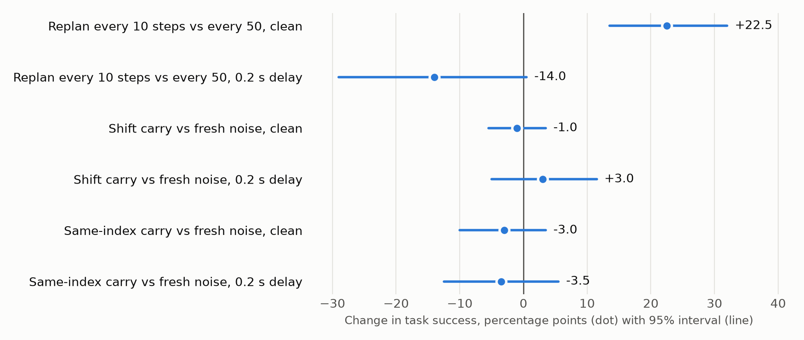
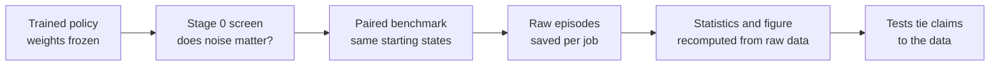

<div align="center">

# Posterior Transport Policy

### Does remembering the noise make a robot's flow-matching policy better?

**We built the idea, tried to break it on a real vision-language-action model, and published what happened.**<br>
**The noise trick did not hold up. A far larger effect turned up instead: one that reverses under 0.2 seconds of delay.**

[](https://github.com/meta-lucky-builds/posterior-transport-policy/actions/workflows/tests.yml)


[Key findings](#key-findings) · [Method](#the-method) · [How to read this](#how-to-read-this-work) · [Reproduce](#reproduce) · [Full evidence](docs/FINDINGS.md)

</div>

---

## The result

| Question | Answer on SmolVLA + LIBERO |
|---|---|
| **Does carrying noise beat standard flow matching?** | **No improvement shown.** Shift carry: **+1.0 points** (95% interval −3.2 to +5.5) |
| **Does replanning every 10 steps beat every 50, clean?** | **Yes, by +22.5 points**, on all 10 of 10 tasks (p ≈ 2×10⁻¹⁰) |
| **Does that still hold with a 0.2 s observation delay?** | **No, it reverses: −14.0 points** (p ≈ 0.002) |



<sub>Paired differences on 200 episodes per row. Intervals resample both tasks and episodes.</sub>

## Why this matters

Flow-matching robot policies draw fresh random noise every time they replan, so two plans in a row can disagree for no physical reason. **Posterior Transport Policy (PTP)** carries part of that noise forward so consecutive plans stay related. It needs no retraining and only a thin wrapper around an existing model. If it worked, it would be close to a free upgrade for deployed policies, which is exactly why it deserved a serious attempt to break it.

Three things make this more useful than a single benchmark number:

- **A clean negative result, with its reasons.** The noise carry failed, and a pre-declared screen shows why: on this model, noise barely changes the actions.
- **A deployment warning.** On these tasks, the setting that looks best in clean simulation became clearly worse once a 0.2 s observation delay appeared.
- **A method others can reuse.** The under-20-minute screen, the paired design and the source-level pitfalls apply to any source-noise idea.

## The method



| Discipline | How it was applied |
|---|---|
| **Decision rules written first** | Thresholds and verdict rules are fixed in [`protocol.json`](ptp_vla/protocol.json) |
| **Matched comparisons** | Every method faced the same episodes: 0 of 1,600 start-state mismatches |
| **Two strengths of evidence** | Separate intervals for "these tasks" and "tasks like these" |
| **First-principles checks** | Exact flow-matching simulations test the mechanism with no learned network |
| **Failure-tolerant execution** | Workers save each job themselves, and runs restart and resume after a crash |

---

## Key findings

### 1. Noise carry did not improve task success
Same checkpoint, same starting states, 400 paired episodes per method, on 10 tasks from two LIBERO suites.

| Method | Success | vs fresh noise, L=10 | 95% interval |
|---|---|---|---|
| Shift carry, L=10, ρ=0.9 *(the spec's design)* | 68.5% | **+1.0** | −3.2 to +5.5 |
| **Fresh noise, L=10** *(standard sampling)* | **67.5%** | reference | |
| Same-index carry, L=10, ρ=0.9 *(declared primary test)* | 64.25% | **−3.25** | −8.3 to +2.3 |
| Native L=50 *(checkpoint default, standard sampling)* | 63.25% | −4.25 | −13.8 to +5.2 |

A gain much above 5 points from shift carry looks unlikely on this model. A small gain is not ruled out.

### 2. The replanning interval is the big lever, and its sign depends on delay

| Condition | L=50 | L=10 | Difference | Paired wins | Exact p |
|---|---|---|---|---|---|
| **Clean** | 67.0% | **89.5%** | **+22.5** (95% interval +13.5 to +32.0) | 50 vs 5 | 2.1×10⁻¹⁰ |
| **0.2 s delay** | **59.5%** | 45.5% | **−14.0** (95% interval −29.0 to +0.5) | 25 vs 53 | 0.002 |

The overall gap of +4.25 points looks like nothing, but it is two large opposite effects averaged together. A checkpoint evaluated only in clean simulation would suggest replanning as often as possible, which may be the wrong advice for hardware with real latency.

This was **not the planned test**, so treat it as a strong lead to confirm on fresh tasks. The checkpoint was not trained on delay, and no delay compensation was used.

### 3. Keeping a behavior mode is not the same as succeeding
At a fixed observation, carrying noise at the *same token index* kept the sampled mode far more often. Carrying it with *time alignment* barely did anything:

| Carry type (ρ=0 → ρ=0.95) | Mode kept |
|---|---|
| **Same-index** | 62.0% → **91.0%** |
| Shift (time-aligned, fresh tail) | 59.8% → 60.7% |
| Cyclic (time-aligned, recycled tail) | 60.7% → 61.9% |

That runs against the intuition behind aligned noise on this model, and it was the reason same-index carry became the primary test. It then scored lowest among the L=10 methods. Measurable commitment did not produce more successful episodes.

### 4. Noise has little to act on here
The pre-declared Stage 0 screen returned **NO-GO** before any comparison ran, and the benchmark agreed with it.

| Check | Measured | Required | |
|---|---|---|---|
| Model can do the tasks | 46% | 30% | Pass |
| Noise changes executed actions (std, normalized units) | 0.038 | 0.05 | **Fail** |
| Noise acts locally in time | 0.206, against 0.208 for uniform | 0.60 | **Fail** |
| Shift carry keeps the mode | +0.8 points | +10 | **Fail** |
| Shift carry smooths plans | 4.3% worse | 20% better | **Fail** |

The whole screen took under 20 minutes and pointed to the outcome. It is a cheap check to run before investing in any source-noise method. *One caution: about 90% of the locality signal comes from two action tokens, so that single number is weak evidence.*

### 5. Time-aligned carry has hard limits that follow from its structure
These results came from first principles and were then confirmed with exact flow-matching simulations. They apply before any network is trained.

- **Memory ends after H/L replans.** With a fresh tail, noise is fully replaced, so Z at replan *k+H/L* is exactly independent of Z at replan *k* at any ρ. Measured correlation: 0.006, at the Monte Carlo noise floor.
- **Mode retention per replan is capped.** For two symmetric modes it is about ½ + arcsin(r)/π, with r = ρ(H−L)/H for uniform separation. At H=16, L=4, even ρ→1 flips about 23% of the time.
- **Alignment trades against memory.** In simulation at ρ=0.95, aligned shift gave 0.76 mode retention with low plan jitter (0.13). Same-index gave 0.90 with higher jitter (0.32).
- **Isotropic carry is inefficient.** At ρ=0.95 it spends about 98 nats of latent commitment to protect a binary choice worth at most 0.69 nats.

### 6. A small tuning budget can invent a winner
With 12 settings at 20 episodes each and **no real difference at all**, the best setting appears to gain 13 points at a true success rate of 80%, and it beats the baseline by 10+ points 51% of the time. Detecting a real 5-point gain needs about 900 episodes per arm. The final comparison here therefore never reuses settings search data for its claims, and the quick run fixes its settings in advance.

### 7. Details that silently decide this kind of benchmark
Each of these came from reading the pinned source code, and each would have corrupted or voided results:

| Detail in LeRobot + `smolvla_libero` | What goes wrong otherwise |
|---|---|
| `n_action_steps` = `chunk_size` = 50 | Chunks never overlap, so aligned carry at native settings has nothing to carry |
| Noise is `(B, 50, 32)`, not `(B, 50, 7)` | The model also receives noise in 25 padded dimensions |
| An empty `rename_map` overrides the saved camera mapping | Cameras silently fail to match the checkpoint |
| LIBERO's `init_state_id` advances on every reset | Reused environments give each method different starting states, which breaks pairing |
| A batch of simulators shares one action queue, and finished ones replay their last frame | Metrics and captured states get polluted by frozen episodes |

---

## How to read this work

- **Valid run:** 80 of 80 jobs, 1,600 episodes, **0 of 1,600** start-state mismatches, no restarts, 24 minutes on 4× RTX 5090.
- **Decision rules were written down first:** thresholds and verdict rules live in [`ptp_vla/protocol.json`](ptp_vla/protocol.json). This repository's history starts after the runs, so that order is documented rather than provable from git.
- **Every headline number is recomputed from raw episodes:** `tests/` fails if the numbers on this page stop matching [`results/`](results/).

**What this does not show.** It is one checkpoint in simulation, with 20 episodes per job and settings fixed by hand. The test tasks have now been seen, so any follow-up should use new ones. It says nothing about real hardware, a decoder *retrained* for correlated noise, or the spec's optional RL, trained-intent and recovery components, none of which were run. Competing methods (EAPN, CTP, MOSS, RTC) were not compared, and a planned full settings search was cut short: one run crashed before saving, and a smaller fixed-settings run replaced it. See the [post-mortem](docs/POSTMORTEM.md).

---

## Reproduce

Recompute every number and the figure from the included raw results, with no GPU:

```bash
pip install -r requirements.txt
python analysis/analyze_results.py
```

```bash
pytest tests
```

Rerun the real benchmark on an Ubuntu machine with NVIDIA GPUs. It handles installation, tests EGL rendering with repair and fallback, uses every GPU, saves each job as it finishes, and restarts itself after a crash:

```bash
bash ptp_vla/go.sh quick
```

```bash
python3 ptp_vla/status.py
```

Rerun the exact-flow mechanism analysis:

```bash
python analysis/toy_mechanism.py
```

## Repository map

| Path | Contents |
|---|---|
| [`ptp_vla/`](ptp_vla/) | **The real benchmark:** noise wrapper, Stage 0, multi-GPU runner, protocol |
| [`results/`](results/) | Raw per-episode results, Stage 0 outputs, run logs, recomputed summary |
| [`analysis/`](analysis/) | Reproducible statistics, figure and exact-flow mechanism simulations |
| [`point_mass/`](point_mass/) | Controlled 2-D diagnostic with a verified A\*+QP expert. Code is tested, **but no trained-policy result exists** |
| [`docs/FINDINGS.md`](docs/FINDINGS.md) | Full evidence behind every finding |
| [`docs/SPEC_SUMMARY.md`](docs/SPEC_SUMMARY.md) | What PTP is, and what was and was not implemented |
| [`docs/POSTMORTEM.md`](docs/POSTMORTEM.md) | How the first full run failed and what changed |

## Where to go next

1. **Confirm the replanning and delay interaction** on fresh tasks, across several L values and delays.
2. **Test delay compensation**, because the reversal suggests latency-aware execution may matter more than source noise.
3. **Try carry on a policy with real behavioral multimodality**, where noise visibly changes outcomes. Run the Stage 0 screen first.

## Credits and related work

This work was carried out in collaboration with an internal research harness built by the author.

Built on [LeRobot](https://github.com/huggingface/lerobot), [SmolVLA](https://arxiv.org/abs/2506.01844) and [LIBERO](https://arxiv.org/abs/2306.03310). Closest prior work: [EAPN](https://arxiv.org/abs/2610.06090) (execution-aligned noise with a retrained decoder), [DSRL](https://arxiv.org/abs/2506.15799) (RL over latent noise of a frozen policy), [RTC](https://arxiv.org/abs/2506.07339) (real-time action chunking) and [PYoCo](https://arxiv.org/abs/2305.10474) (correlated noise for video). PTP does not claim novelty over these.

Contributions are welcome, including results that disagree with these. See [CONTRIBUTING.md](CONTRIBUTING.md).
